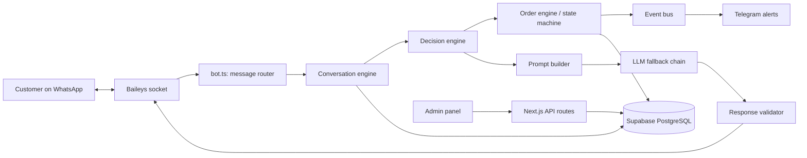

# Flora — WhatsApp Sales Assistant for Jardín RoCé


Flora is the WhatsApp sales and customer-service system of **Jardín RoCé**, a flower shop in Apizaco, Tlaxcala (Mexico). Customers talk to Flora on WhatsApp, and the shop team supervises everything from a web admin panel.

> Operations manual (Spanish): [docs/OPERATIONS_ES.md](docs/OPERATIONS_ES.md)

## Business Problem

Quotes, orders, payment confirmation, production and delivery were coordinated by hand over WhatsApp. Information was spread across chats, orders got lost, and the owner had no structured record of sales.

## Solution

A TypeScript backend that **owns every business decision** (order state, schedules, prices, branches) and uses an LLM **only to write the reply** from data the backend has already validated. Every interaction is stored in PostgreSQL, and staff are alerted from domain events, not from LLM text.

## Key Features

- **WhatsApp channel** with Baileys (no browser), media handling (photos, voice notes, files) and an outbound message queue.
- **Decision engine** that detects intents (purchase, cancellation, complaint, human hand-off, and more).
- **Order engine** implemented as a state machine with validated transitions. Orders live in the database, independently of the conversation.
- **Conversation → Case → Order** separation, so stale data is never reused weeks later.
- **Response validator** that rejects replies inventing schedules, prices, branches or payment details.
- **Multi-provider AI fallback**: Gemini (primary) → OpenRouter → Groq → Cerebras, with a concurrency limiter.
- **Typed event bus** with subscribers (Telegram alerts, auditing).
- **Admin panel** (Next.js): dashboard, WhatsApp inbox with manual replies, orders, shipping zones by municipality (CSV import/export), prompt editor with history, silenced numbers, staff, logs, reports and bot health/QR pairing. Protected by Supabase Auth.

## Technology Stack

| Layer | Technology |
|---|---|
| Runtime | Node.js 22, TypeScript 5, `tsx` |
| Messaging | `@whiskeysockets/baileys` 7 (WhatsApp), Telegram Bot API |
| AI | Gemini API + OpenAI-compatible providers (OpenRouter, Groq, Cerebras) |
| Bot API | Express 5 |
| Admin panel | Next.js 16, React 19, Tailwind CSS 4 |
| Data | Supabase (PostgreSQL + Storage), SQL migrations |
| Ops | Dockerfile, systemd unit (`floreria-bot.service`), Vercel (panel) |

## Architecture



## Project Structure

```text
bot.ts                  WhatsApp bot entry point
app/admin/*             admin panel pages
app/api/*               admin REST endpoints
lib/                    AI provider chain, Supabase clients, logger, metrics
src/conversation/       history, deduplication, topic changes
src/decision/           intent detection and priorities
src/pedidos/            order service and state transitions
src/casos/              case lifecycle
src/events/             typed event bus + Telegram subscriber
src/validators/         schedule, price and response validators
src/whatsapp/           transport helpers, media, outbox
scripts/lib/            env-based configuration for local maintenance scripts
supabase_migration_*.sql
tests/                  flow, unit and security tests
```

## Running Locally

Requirements: Node.js 22, a Supabase project, at least one AI provider key and a WhatsApp number to pair.

```bash
git clone https://github.com/cantedavid00-afk/jardin-roce-bot.git
cd jardin-roce-bot
npm install
cp .env.example .env.local      # fill in your values
npm run bot:dev                 # WhatsApp bot (scan the QR in the terminal or in /admin)
npm run dev                     # admin panel at http://localhost:3000/admin
npm run test:security           # security tests (no network, no credentials)
```

Apply the SQL migrations to your Supabase project first (`supabase_migration_completa.sql`).

## Security

- The service key never reaches the browser: client code uses only the publishable key; server code uses the secret key (`sb_secret_…`).
- Local maintenance scripts read credentials from the environment, enforce least privilege (public vs. admin key) and fail safely without printing values.

## Status

In use by the shop and under continuous improvement (see `CHANGELOG.md` and `DECISIONS.md`). The admin panel is private, so there is no public demo.
